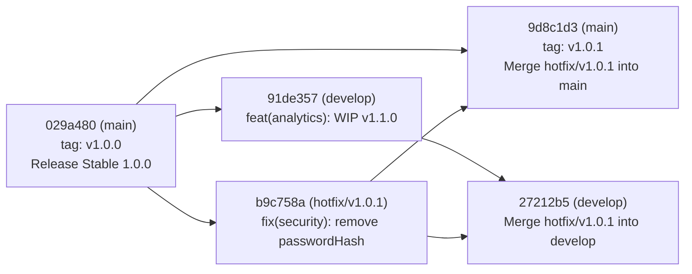
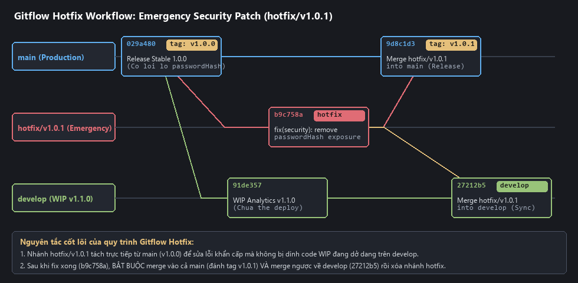
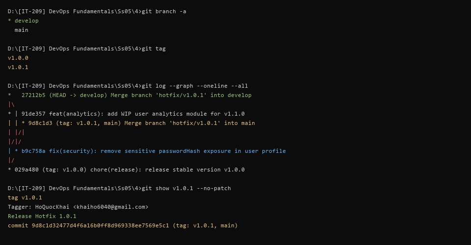

# Báo Cáo Bài Tập 4: Mô Phỏng Quy Trình Hotfix & Gitflow Thực Tế

- **Môn học**: DevOps Fundamentals (IT-209)
- **Session**: 05 - Git Advanced & Recovery
- **Bài tập**: Bài 4 - Mô phỏng quy trình Hotfix & Gitflow thực tế
- **Đường dẫn nộp bài trên GitHub**: `homework/session_05/ex4/`
- **Học viên**: HoQuocKhai
- **Email**: khaiho6040@gmail.com

---

## 1. Mục tiêu bài thực hành
1. **Áp dụng mô hình phân nhánh Gitflow chuẩn**: Tổ chức rõ ràng vai trò giữa nhánh sản phẩm ổn định (`main`), nhánh tích hợp phát triển (`develop`) và nhánh vá lỗi khẩn cấp (`hotfix/*`).
2. **Xử lý sự cố Production bằng nhánh Hotfix (`hotfix/v1.0.1`)**: Tách nhánh trực tiếp từ `main` (`v1.0.0`) để vá lỗ hổng lộ dữ liệu người dùng mà không bị ảnh hưởng bởi các tính năng đang làm dở trên `develop`.
3. **Phát hành bản vá (`v1.0.1`) và đồng bộ ngược về `develop`**: Gộp bản vá vào `main`, gắn thẻ `v1.0.1`, đồng thời gộp ngược (`back-merge`) về `develop` để ngăn chặn lỗi tái xuất hiện ở các phiên bản tương lai, sau đó dọn dẹp nhánh `hotfix/v1.0.1`.

---

## 2. Giải thích mô hình phân nhánh Gitflow & Sơ đồ Merge

### 2.1. Vai trò các nhánh trong Gitflow
| Nhánh | Thời gian tồn tại | Tách ra từ | Gộp vào | Vai trò trong bài thực hành |
| :--- | :--- | :--- | :--- | :--- |
| **`main`** | Vĩnh viễn (Long-lived) | - | - | Lưu trữ mã nguồn Production ổn định (`v1.0.0`, `v1.0.1`). Mỗi lần cập nhật đều được đánh `tag` phiên bản. |
| **`develop`** | Vĩnh viễn (Long-lived) | `main` | `release/*` $\rightarrow$ `main` | Chứa mã nguồn đang phát triển cho phiên bản tiếp theo (`v1.1.0`), chưa đủ điều kiện deploy ngay. |
| **`hotfix/v1.0.1`** | Tạm thời (Short-lived) | **`main`** | **`main`** VÀ **`develop`** | Khắc phục khẩn cấp lỗi lộ thông tin nhạy cảm (`passwordHash`) trên môi trường Production rồi tự xóa sau khi hoàn tất. |

### 2.2. Sơ đồ phân nhánh và gộp nhánh bằng ASCII
```text
main (Production)    :  [029a480 (tag: v1.0.0)] -------------------------> [9d8c1d3 (tag: v1.0.1)]
                           |                  \                              /
                           |                   \                            / (1. Merge hotfix -> main & Tag v1.0.1)
hotfix/v1.0.1        :     |                    +---> [b9c758a: Security Fix]
                           |                                                \
                           v                                                 \ (2. Back-merge hotfix -> develop)
develop (WIP v1.1.0) :  +---------------------> [91de357: WIP Analytics] ----> [27212b5: Merge hotfix into develop]
```

### 2.3. Sơ đồ luồng Gitflow bằng Mermaid


---

## 3. Quá trình thực hiện chi tiết

### Bước 1: Khởi tạo nhánh `main` (phiên bản `v1.0.0`) và nhánh `develop`
Khởi tạo kho chứa trên nhánh `main` với tệp [user_service.js](file:///d:/%5BIT-209%5D%20DevOps%20Fundamentals/Ss05/4/user_service.js) đang chạy ở phiên bản `v1.0.0` (chứa lỗi trả về trường nhạy cảm `passwordHash`):
```bash
git init -b main
git config --local user.name "HoQuocKhai"
git config --local user.email "khaiho6040@gmail.com"
git add user_service.js
git commit -m "chore(release): release stable version v1.0.0"
git tag -a v1.0.0 -m "Release Stable 1.0.0"
```
**Kết quả:** `[main (root-commit) 029a480] chore(release): release stable version v1.0.0` (kèm tag `v1.0.0`).

Tách nhánh `develop` từ `main` và phát triển tính năng mới đang dở dang (`getUserAnalytics` cho bản `v1.1.0`):
```bash
git checkout -b develop
# Bổ sung hàm getUserAnalytics đang phát triển (WIP) vào user_service.js
git add user_service.js
git commit -m "feat(analytics): add WIP user analytics module for v1.1.0"
```
**Kết quả:** `[develop 91de357] feat(analytics): add WIP user analytics module for v1.1.0`

---

### Bước 2: Tách nhánh `hotfix/v1.0.1` trực tiếp từ `main` và vá lỗi bảo mật
Khi phát hiện lỗi lộ `passwordHash` trên Production (`main`), quay về `main` và tách nhánh `hotfix/v1.0.1`:
```bash
git checkout main
git checkout -b hotfix/v1.0.1
```

Sửa lỗi trong [user_service.js](file:///d:/%5BIT-209%5D%20DevOps%20Fundamentals/Ss05/4/user_service.js) bằng cách loại bỏ trường `passwordHash` khỏi dữ liệu phản hồi của `getUserProfile(user)` và commit bản vá:
```javascript
// User Service - Production Release v1.0.1 (Hotfix Applied)
function getUserProfile(user) {
    // HOTFIX v1.0.1: Loai bo passwordHash de ngan chan rui ro lo du lieu nhay cam
    return {
        id: user.id,
        username: user.username,
        email: user.email
    };
}
```
```bash
git add user_service.js
git commit -m "fix(security): remove sensitive passwordHash exposure in user profile"
```
**Kết quả:** `[hotfix/v1.0.1 b9c758a] fix(security): remove sensitive passwordHash exposure in user profile`

---

### Bước 3: Gộp `hotfix/v1.0.1` vào `main` và đánh Tag `v1.0.1`
Chuyển về nhánh `main`, tích hợp nhánh hotfix và gắn thẻ phát hành `v1.0.1`:
```bash
git checkout main
git merge --no-ff hotfix/v1.0.1 -m "Merge branch 'hotfix/v1.0.1' into main"
git tag -a v1.0.1 -m "Release Hotfix 1.0.1"
```
**Kết quả thực tế:**
```text
Switched to branch 'main'
Merge made by the 'ort' strategy.
 user_service.js | 7 +++----
 1 file changed, 3 insertions(+), 4 deletions(-)
```
Commit mới trên `main` mang mã hash `9d8c1d3` được gắn tag `v1.0.1`.

---

### Bước 4: Gộp ngược `hotfix/v1.0.1` vào `develop` và dọn dẹp nhánh Hotfix
Chuyển sang nhánh `develop`, gộp nhánh `hotfix/v1.0.1` để đồng bộ bản vá bảo mật vào luồng phát triển tương lai, sau đó xóa nhánh `hotfix/v1.0.1`:
```bash
git checkout develop
git merge --no-ff hotfix/v1.0.1 -m "Merge branch 'hotfix/v1.0.1' into develop"
git branch -d hotfix/v1.0.1
```
**Kết quả thực tế:**
```text
Switched to branch 'develop'
Auto-merging user_service.js
Merge made by the 'ort' strategy.
 user_service.js | 7 +++----
 1 file changed, 3 insertions(+), 4 deletions(-)
Deleted branch hotfix/v1.0.1 (was b9c758a).
```

---

## 4. Kết quả kiểm tra theo yêu cầu đề bài

### 4.1. Kiểm tra danh sách nhánh và danh sách Tag (`git branch -a`, `git tag`)
```bash
git branch -a
```
**Kết quả thực tế:**
```text
* develop
  main
```
*(Nhánh tạm `hotfix/v1.0.1` đã được xóa sạch sau khi hoàn thành nhiệm vụ).*

```bash
git tag
```
**Kết quả thực tế:**
```text
v1.0.0
v1.0.1
```

### 4.2. Kiểm tra sơ đồ lịch sử gộp nhánh (`git log --graph --oneline --all`)
```bash
git log --graph --oneline --all
```
**Kết quả thực tế:**
```text
*   27212b5 (HEAD -> develop) Merge branch 'hotfix/v1.0.1' into develop
|\  
* | 91de357 feat(analytics): add WIP user analytics module for v1.1.0
| | * 9d8c1d3 (tag: v1.0.1, main) Merge branch 'hotfix/v1.0.1' into main
| |/| 
|/|/  
| * b9c758a fix(security): remove sensitive passwordHash exposure in user profile
|/  
* 029a480 (tag: v1.0.0) chore(release): release stable version v1.0.0
```
-> **Đánh giá**:
- Tag `v1.0.1` trỏ chính xác vào commit phát hành bản vá `9d8c1d3` trên nhánh `main`.
- Nhánh `develop` (`27212b5`) đã kế thừa đầy đủ commit sửa lỗi bảo mật `b9c758a` từ `hotfix/v1.0.1` đồng thời vẫn giữ nguyên tính năng đang phát triển `91de357` (`getUserAnalytics`).

---

## 5. Ảnh chụp màn hình minh chứng

### Minh chứng 1: Sơ đồ trực quan hóa luồng Gitflow Hotfix (`main`, `hotfix/v1.0.1`, `develop`)


### Minh chứng 2: Kết quả chạy lệnh `git branch -a`, `git tag` và `git log --graph --oneline --all` trên Terminal


---

## 6. Bài học kinh nghiệm
1. **Tại sao bắt buộc phải Back-merge Hotfix về `develop`?**: Nếu chỉ gộp `hotfix/v1.0.1` vào `main` mà quên gộp về `develop`, thì ở lần phát hành tiếp theo (`v1.1.0` từ `develop` sang `main`), lỗi bảo mật cũ sẽ xuất hiện trở lại (Regression Bug).
2. **Sử dụng `--no-ff` trong Gitflow**: Cờ `--no-ff` (No Fast-Forward) đảm bảo Git luôn tạo một Merge Commit tường minh khi gộp nhánh `hotfix/` vào `main` và `develop`, giúp đội ngũ DevOps dễ dàng truy vết thời điểm phát hành bản vá trên đồ thị lịch sử.
